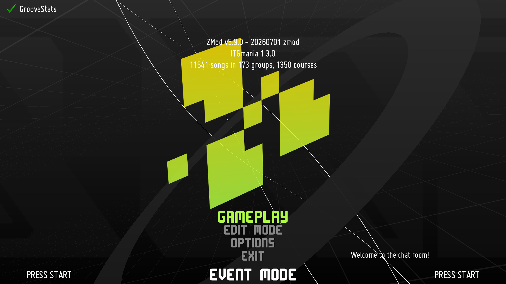
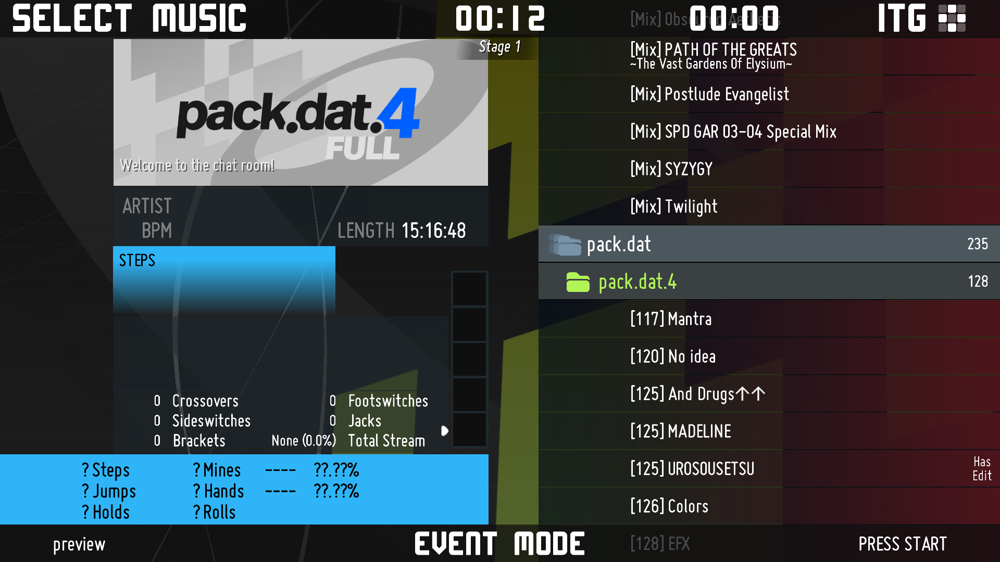
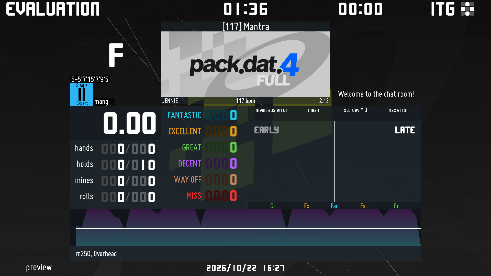
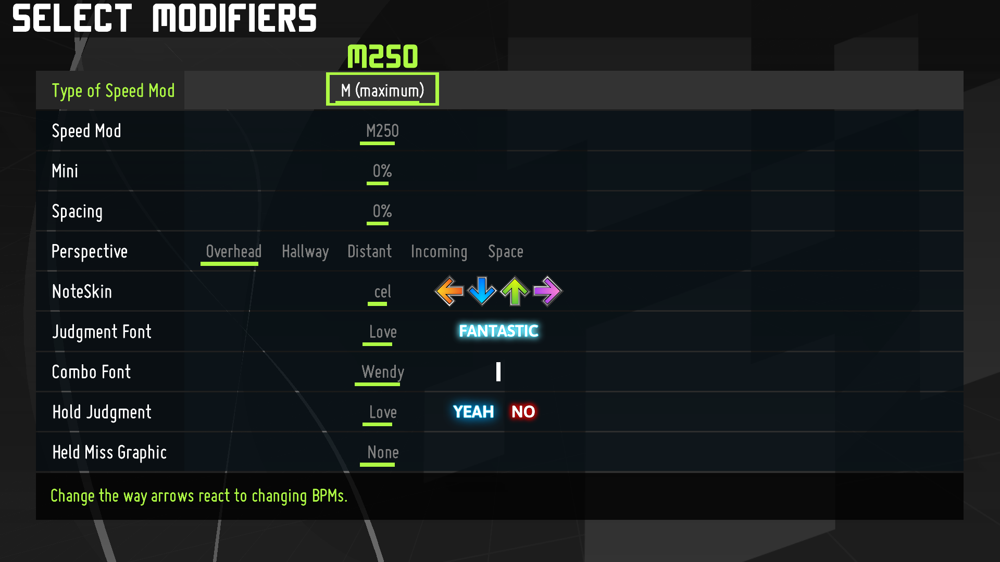

# Datum

Datum is a Visual Style for Simply Love-based themes (Primarily developed on the Simply Love ZMod fork).

This style attempts to build off of the futuristic, techy visual style known as "Technique", the default style used in ZMod. It is heavily altered to fit the design language created for the **pack.dat** simfile pack series. It also attempts to use its per-screen layout features to improve the visual clarity of screens.

## Screenshots

<table>
  <tr>
    <td align="center"><strong>Main Menu (ScreenTitleMenu)</strong></td>
    <td align="center"><strong>Song Select (ScreenSelectMusic)</strong></td>
  </tr>
  <tr>
    <td width="50%"></td>
    <td width="50%"></td>
  </tr>
  <tr>
    <td align="center"><strong>Evaluation (ScreenEvaluation)</strong></td>
    <td align="center"><strong>Player Options (ScreenPlayerOptions)</strong></td>
  </tr>
  <tr>
    <td width="50%"></td>
    <td width="50%"></td>
  </tr>
</table>

## Features

- User Options (within `DatumOptions.lua`)
- Integrated "Rainbow" mode
- Per-screen visual layouts
- Screen transitions
- Optional music and sound theme
- Automatic installation script (Windows & Linux)

The Technique visual style is directly integrated within the ZMod theme across many of its theme files. One of the main goals of the Datum visual style is to provide a similar quality style to Technique while minimizing installation steps for the user. The main way this was accomplished was by documenting each of the theme edits & conditionals that Technique had applied to the theme and replicating it directly from the main `_shared background/Datum.lua`.

## Installing Datum

**Linux**:
1. Download the latest version of the visual style from the repository.
2. Unzip the downloaded file into its own folder.
   - At this point, you can optionally open `DatumOptions.lua` in a text editor and customize the available user options.
3. Open the terminal inside the root folder of the visual style (the folder where the `install.sh` is contained).
4. Copy the installation path of the theme you wish to install the Datum  visual style on. (e.g `~/.itgmania/Themes/ZMod/`)
5. Grant execution permission to the install script using `chmod +x install.sh`
6. Run the script by typing `./install.sh`, and input the theme path along with the prompted style installation options.
7. Enable the visual style by opening ITGmania, navigating to `Options > Simply Love Options > Visual Style`, and setting the Visual Style to "💾" (Floppy Disk emoji)

**Windows**:
1. Download the latest version of the visual style from the repository.
2. Unzip the downloaded file into its own folder.
   - At this point, you can optionally open `DatumOptions.lua` in a text editor and customize the available user options.
3. Copy the installation path of the theme you wish to install the Datum  visual style on. (e.g. `C:\Games\ITGmania\Themes\ZMod`)
4. Open the terminal in the root of the visual style (the folder where the `install.ps1` is contained). You can do this quickly by typing `cmd` into the address bar of the File Explorer.
5. Run the installation script: `powershell.exe -NoProfile -ExecutionPolicy Bypass -File ".\install.ps1"` 
6. Input the theme path along with the other style installation options.
7. Enable the visual style by opening ITGmania, navigating to `Options > Simply Love Options > Visual Style`, and setting the Visual Style to "💾" (Floppy Disk emoji)

**Manual Installation (All Platforms)**
For manual installations, Check out the included [Manual Installation Guide](manual_install.md).

If any graphical glitches, lua errors, or performance issues, please submit them as an Issue on the repository or otherwise contact me.